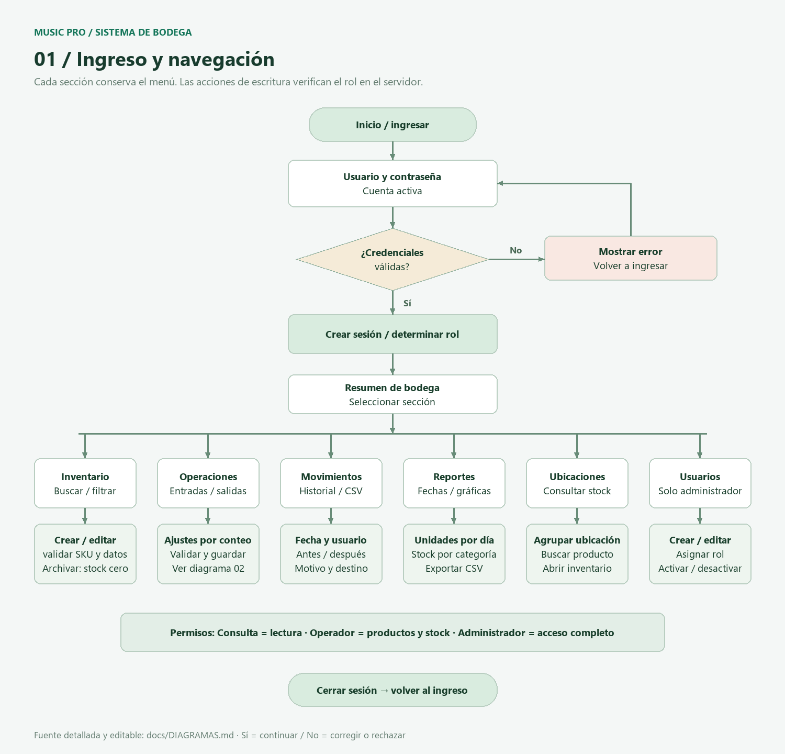

# SoundStock · Bodega Music Pro

Sistema de bodega en Django con **una única versión y base de datos SQLite**: inventario, ubicaciones, entradas, salidas, ajustes, historial, gráficas, CSV y roles. La plantilla principal `index.html` está en la carpeta raíz, junto a `manage.py` e `iniciar.bat`.

## Cómo acceder

1. Instala Python 3.12 con el lanzador `py` y extrae el ZIP completo.
2. Abre la carpeta **SoundStock**, donde están `index.html` y `manage.py`.
3. Ejecuta **iniciar.bat**. La primera ejecución instala dependencias, prepara la base y solicita una cuenta administradora si no existe una activa. La contraseña no se muestra al escribir.
4. Si el inventario está vacío, puedes cargar productos ficticios para probar el sistema.
5. Abre [http://127.0.0.1:8000/ingresar/](http://127.0.0.1:8000/ingresar/) e ingresa con tu cuenta.
6. Navega mediante el menú: todas las secciones se abren en la misma pestaña.
7. Mantén abierta la consola. Para detener el servidor, presiona **Ctrl+C**. Para volver, ejecuta otra vez `iniciar.bat`.

En el equipo original se conserva la cuenta **Pablo Doussang** y la contraseña que configuraste. Las cuentas y la base local no se distribuyen en el ZIP ni en GitHub; una instalación nueva solicita crear su propia cuenta. Los nombres de usuario admiten espacios.

No abras `index.html` con doble clic: es una plantilla que Django debe procesar. Accede por la dirección del servidor.

## Dónde se guardan los datos

La base **`db.sqlite3`**, en la carpeta principal, contiene usuarios, administradores, permisos, productos, existencias, movimientos y sesiones. Las contraseñas se guardan mediante hash. La ruta de la base depende de la carpeta del proyecto, no de dónde abras la consola.

| Acción | Resultado |
|---|---|
| Guardar un usuario, producto o movimiento válido | El servidor confirma el cambio en SQLite |
| Refrescar o cambiar de sección | Se leen los datos guardados en la base |
| Cerrar sesión, cerrar el navegador o apagar el equipo | Se conservan las cuentas y los datos; puede ser necesario ingresar de nuevo |
| Volver a ejecutar `iniciar.bat` | Se reutiliza la misma base; no se restablece el inventario |
| Editar directamente la misma base y confirmar la transacción | El cambio permanece y se ve al recargar la sección correspondiente |
| Escribir en un formulario sin pulsar Guardar | El borrador no se conserva al abandonar la página |

La aplicación **no guarda una copia de los datos en el navegador**. Cerrar sesión elimina el acceso de esa sesión, no tu cuenta ni el inventario. Una sesión puede vencer a las 8 horas sin borrar los datos.

Para cambios directos en SQLite, confirma con **Guardar cambios / Write Changes / COMMIT** en la herramienta que utilices. Un cambio sin confirmar puede revertirse al cerrar esa herramienta. Las contraseñas deben cambiarse desde Usuarios y roles, Django Admin o `changepassword`, que generan el hash correcto. Las existencias se modifican desde Operaciones de stock para registrar también el historial.

**Conserva `db.sqlite3` al actualizar el código.** No lo borres ni lo reemplaces por una base vacía. Extraer el proyecto en otra carpeta crea una instalación independiente. Para conservar datos en otra instalación, detén el servidor, copia la base a la carpeta de destino y vuelve a iniciar. La carga de catálogo es opcional y no sobrescribe un inventario existente.

## Copia de seguridad y actualización

1. Detén el servidor con Ctrl+C y cierra cualquier editor de SQLite.
2. Copia `db.sqlite3` a una carpeta de respaldo privada fuera del repositorio.
3. Actualiza los archivos de código conservando `db.sqlite3` y `.local-secret`.
4. Ejecuta `iniciar.bat`; las migraciones pendientes se aplican sobre la base existente.

GitHub y el ZIP contienen código, no respaldos de tus cuentas o inventario. No publiques copias de la base ni contraseñas.

## Si no abre o no te deja entrar

- **No se puede conectar:** ejecuta `iniciar.bat` y espera el mensaje de arranque. La dirección local funciona en ese equipo mientras el servidor esté abierto.
- **Usuario o contraseña incorrectos:** revisa mayúsculas, espacios y símbolos.
- **Acceso restringido:** Consulta tiene lectura; Operador puede modificar productos y stock; Administrador puede además archivar y gestionar usuarios.
- **Puerto ocupado:** utiliza la instancia ya abierta o ciérrala antes de iniciar otra.
- **Falta Python:** instala Python 3.12 y vuelve a ejecutar el iniciador.

## Ejecutar manualmente

Desde la carpeta del proyecto:

```powershell
py -3 -m venv .venv
.\.venv\Scripts\python.exe -m pip install -r requirements.txt
.\.venv\Scripts\python.exe manage.py migrate
.\.venv\Scripts\python.exe manage.py preparar
.\.venv\Scripts\python.exe manage.py runserver 127.0.0.1:8000
```

Para cambiar una contraseña:

```powershell
.\.venv\Scripts\python.exe manage.py changepassword "Pablo Doussang"
```

## Secciones y reglas

| Sección | Funciones |
|---|---|
| Resumen | Referencias activas, unidades, alertas, actividad y gráfica de 14 días |
| Inventario | Alta, edición, búsqueda, filtros, archivo, reactivación y CSV |
| Operaciones de stock | Entrada, salida con destino y ajuste por conteo físico |
| Movimientos | Fecha, usuario, motivo, destino, variación y saldos |
| Reportes | Períodos, gráficos, distribución por categoría y exportación |
| Ubicaciones | Agrupación física y búsqueda de productos |
| Usuarios y roles | Cuentas, roles, estado y contraseñas; solo administrador |

- Los productos nuevos empiezan con stock cero: registra una entrada para incorporar existencias.
- Entrada/salida requiere un entero positivo; las salidas no pueden dejar saldo negativo.
- Un ajuste indica la **cantidad final contada**. El motivo es obligatorio; una salida requiere destino.
- Un producto al mínimo o por debajo genera una alerta.
- Archivar requiere stock cero y conserva el historial.
- Los movimientos no se editan: se corrigen mediante otro movimiento justificado.
- Un mismo envío no se procesa dos veces. Stock e historial se confirman juntos en una transacción.
- Los filtros de fecha afectan movimientos; las alertas y la distribución muestran existencias actuales.

## Estructura

```text
index.html                 Plantilla principal en la raíz
iniciar.bat                Único iniciador, puerto 8000
manage.py                  Administración de Django
config/settings.py         Configuración de SQLite y sesiones
warehouse/                 Modelos, formularios, vistas, servicios y pruebas
warehouse/test_persistence.py  Verificación entre procesos y sesiones
templates/                 Plantillas de las secciones
static/                    CSS, Bootstrap y JavaScript locales
docs/                      Diagramas, modelo de datos y rúbrica
db.sqlite3                 Datos locales; no se distribuye
```

## Verificación reproducible

```powershell
.\.venv\Scripts\python.exe manage.py test warehouse
```

**20 pruebas aprobadas**: 19 de operaciones, validaciones, permisos y renderizado, y una prueba de persistencia en disco que usa tres procesos independientes. Comprueba creación y edición de administradores y productos, contraseña modificada, entrada/salida, recargas, cierre de sesión, nuevo navegador, reinicio y cambios confirmados directamente en la base. Las pruebas usan bases temporales y no modifican tus datos.

## Documentación y entrega

- [Correspondencia con los indicadores](docs/RUBRICA.md)
- [Revisión y correcciones](docs/REVISION_RUBRICA.md)
- [Diagramas de flujo](docs/DIAGRAMAS.md)
- [Modelo de datos](docs/MODELO_DATOS.md)
- [Instrucciones de GitHub](docs/GITHUB.md)
- [Fuentes y decisiones](docs/FUENTES_Y_DECISIONES.md)



Esta versión conserva únicamente SQLite por petición del usuario. El documento original de U1 plantea un prototipo sin base de datos: esta decisión cambia ese alcance y no se presenta como cumplimiento literal de esa condición.

Repositorio creado: [PabloDoussang/SoundStock](https://github.com/PabloDoussang/SoundStock). La publicación de los archivos requiere una subida verificada; disponer del enlace no demuestra por sí solo que el código esté cargado. GitHub almacena código y no ejecuta el servidor Django. El proyecto no incluye tienda, pagos, GPS ni API REST/JWT.
