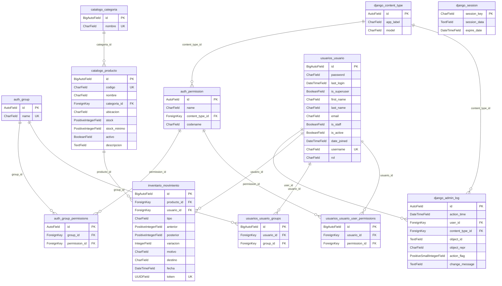

# Diagrama de base de datos · SoundStock

Este archivo se genera desde el código con `python manage.py diagrama_bd`.
Las tablas de negocio son `usuarios_usuario`, `catalogo_categoria`, `catalogo_producto` e `inventario_movimiento`.
Django también crea tablas para permisos, grupos, sesiones y auditoría del Admin.

## Atributos y claves

### auth_group

| Atributo | Tipo SQL | Clave | Relación |
|---|---|---|---|
| id | integer | PK |  |
| name | varchar(150) | UK |  |

### auth_group_permissions

| Atributo | Tipo SQL | Clave | Relación |
|---|---|---|---|
| id | integer | PK |  |
| group_id | integer | FK | auth_group.id |
| permission_id | integer | FK | auth_permission.id |

### auth_permission

| Atributo | Tipo SQL | Clave | Relación |
|---|---|---|---|
| id | integer | PK |  |
| name | varchar(255) |  |  |
| content_type_id | integer | FK | django_content_type.id |
| codename | varchar(100) |  |  |

### catalogo_categoria

| Atributo | Tipo SQL | Clave | Relación |
|---|---|---|---|
| id | integer | PK |  |
| nombre | varchar(60) | UK |  |

### catalogo_producto

| Atributo | Tipo SQL | Clave | Relación |
|---|---|---|---|
| id | integer | PK |  |
| codigo | varchar(30) | UK |  |
| nombre | varchar(120) |  |  |
| categoria_id | bigint | FK | catalogo_categoria.id |
| ubicacion | varchar(60) |  |  |
| stock | integer unsigned |  |  |
| stock_minimo | integer unsigned |  |  |
| activo | bool |  |  |
| descripcion | text |  |  |

Restricciones: `producto_stock_hasta_millon`, `producto_minimo_hasta_millon`.

### django_admin_log

| Atributo | Tipo SQL | Clave | Relación |
|---|---|---|---|
| id | integer | PK |  |
| action_time | datetime |  |  |
| user_id | bigint | FK | usuarios_usuario.id |
| content_type_id | integer | FK | django_content_type.id |
| object_id | text |  |  |
| object_repr | varchar(200) |  |  |
| action_flag | smallint unsigned |  |  |
| change_message | text |  |  |

### django_content_type

| Atributo | Tipo SQL | Clave | Relación |
|---|---|---|---|
| id | integer | PK |  |
| app_label | varchar(100) |  |  |
| model | varchar(100) |  |  |

### django_session

| Atributo | Tipo SQL | Clave | Relación |
|---|---|---|---|
| session_key | varchar(40) | PK |  |
| session_data | text |  |  |
| expire_date | datetime |  |  |

### inventario_movimiento

| Atributo | Tipo SQL | Clave | Relación |
|---|---|---|---|
| id | integer | PK |  |
| producto_id | bigint | FK | catalogo_producto.id |
| usuario_id | bigint | FK | usuarios_usuario.id |
| tipo | varchar(10) |  |  |
| anterior | integer unsigned |  |  |
| posterior | integer unsigned |  |  |
| variacion | integer |  |  |
| motivo | varchar(240) |  |  |
| destino | varchar(120) |  |  |
| fecha | datetime |  |  |
| token | char(32) | UK |  |

Restricciones: `movimiento_saldo_cuadra`, `movimiento_saldo_maximo`, `movimiento_tipo_valido`, `movimiento_signo_valido`, `movimiento_destino_salida`.

### usuarios_usuario

| Atributo | Tipo SQL | Clave | Relación |
|---|---|---|---|
| id | integer | PK |  |
| password | varchar(128) |  |  |
| last_login | datetime |  |  |
| is_superuser | bool |  |  |
| first_name | varchar(150) |  |  |
| last_name | varchar(150) |  |  |
| email | varchar(254) |  |  |
| is_staff | bool |  |  |
| is_active | bool |  |  |
| date_joined | datetime |  |  |
| username | varchar(150) | UK |  |
| rol | varchar(20) |  |  |

### usuarios_usuario_groups

| Atributo | Tipo SQL | Clave | Relación |
|---|---|---|---|
| id | integer | PK |  |
| usuario_id | bigint | FK | usuarios_usuario.id |
| group_id | integer | FK | auth_group.id |

### usuarios_usuario_user_permissions

| Atributo | Tipo SQL | Clave | Relación |
|---|---|---|---|
| id | integer | PK |  |
| usuario_id | bigint | FK | usuarios_usuario.id |
| permission_id | integer | FK | auth_permission.id |

## Correspondencia y reglas

- `catalogo.Categoria` tiene muchos `catalogo.Producto` mediante `Producto.categoria`.
- `catalogo.Producto` y `usuarios.Usuario` tienen muchos `inventario.Movimiento`.
- Las claves foráneas usan `PROTECT` para conservar el historial.
- El SKU, el nombre de categoría, el usuario y el token de movimiento son únicos.
- La base comprueba que `posterior = anterior + variacion` y que el tipo coincida con el signo.
- El servicio registra el movimiento y actualiza el stock en la misma transacción.
