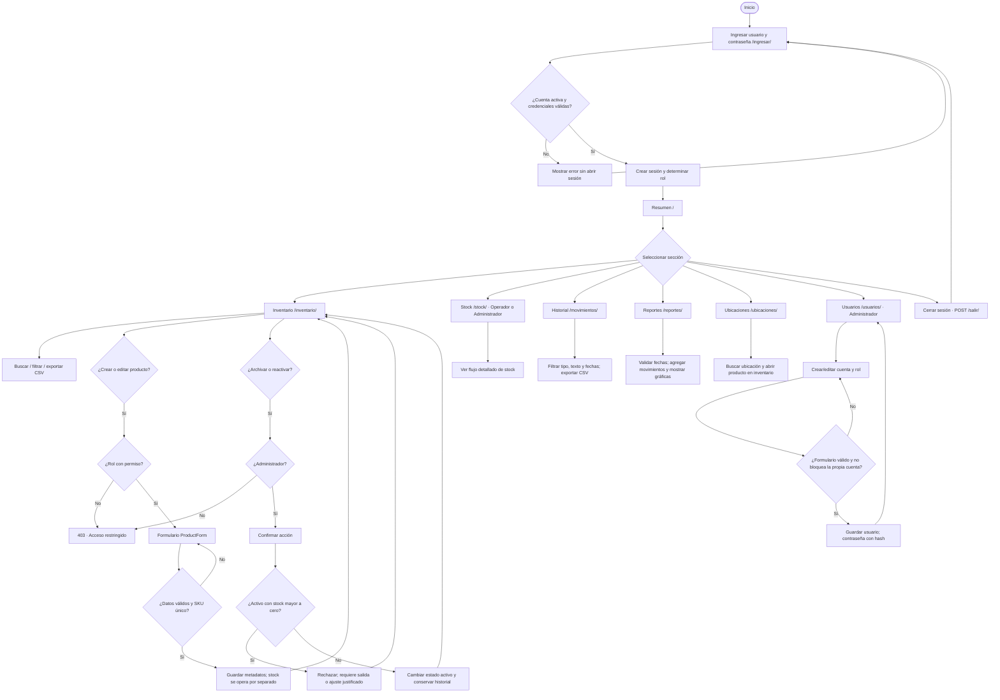
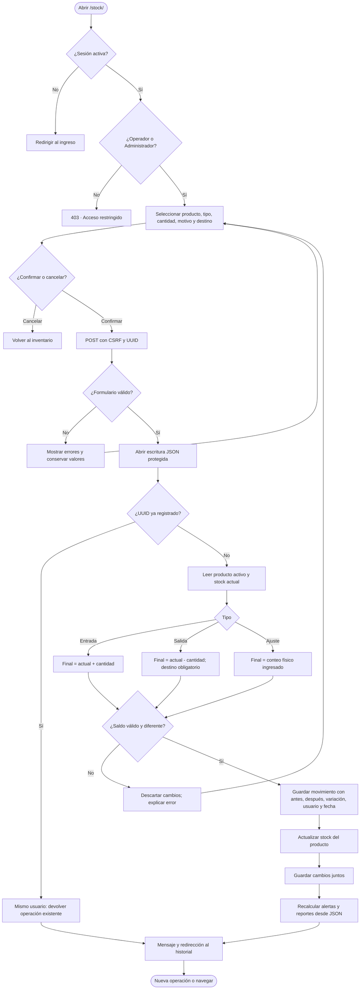

# Diagramas de flujo del sistema

Los diagramas siguientes son editables en Mermaid y se renderizan en GitHub. Los PNG/SVG en esta carpeta permiten verlos sin conexión. El primer diagrama resume la navegación; el segundo detalla la lógica de stock. La fuente Mermaid documenta también las ramas secundarias.

## 1. Ingreso y navegación

Los filtros GET no modifican los datos guardados. Fechas inválidas muestran errores y no devuelven resultados del período. Exportar movimientos con fechas inválidas responde HTTP 400. Cada sección conserva el menú para regresar al resumen o cambiar de sección.

## 2. Operación de stock

Si el producto deja de estar activo, se rechaza sin escribir. Un UUID ajeno se rechaza. El almacén JSON agrupa las escrituras mediante archivo temporal y reemplazo atómico. Si falla antes de confirmar, se conserva el estado anterior. El prototipo usa un único proceso local y no consulta una base de datos.

## 3. Orden para dibujarlo en Draw.io

1. Óvalo: Inicio.
2. Paralelogramo: captura de usuario/contraseña.
3. Rombo: credenciales válidas; rama No al formulario y Sí a sesión/rol.
4. Rectángulo: resumen, seguido de rombo de selección de sección.
5. Una rama por sección según el primer diagrama.
6. Para modificaciones: rombo de permiso → formulario → rombo de validación.
7. Para stock: bloqueo de escritura → UUID → tipo → cálculo → validación de saldo → guardar historial y stock → confirmar.
8. La persistencia se representa con un símbolo de archivo JSON. Conecta errores al formulario y operaciones exitosas al historial.
9. Conecta cierre de sesión al ingreso.
10. Conecta el archivo JSON a las operaciones de lectura y guardado para representar persistencia.

## Persistencia al volver a abrir

Guardar formulario válido → reemplazar runtime/bodega.json → mostrar éxito. Refrescar o cambiar de sección → leer el mismo archivo. Cerrar sesión → invalidar sesión y conservar datos. Reiniciar → abrir el mismo JSON → ingresar y leer los últimos cambios guardados.
