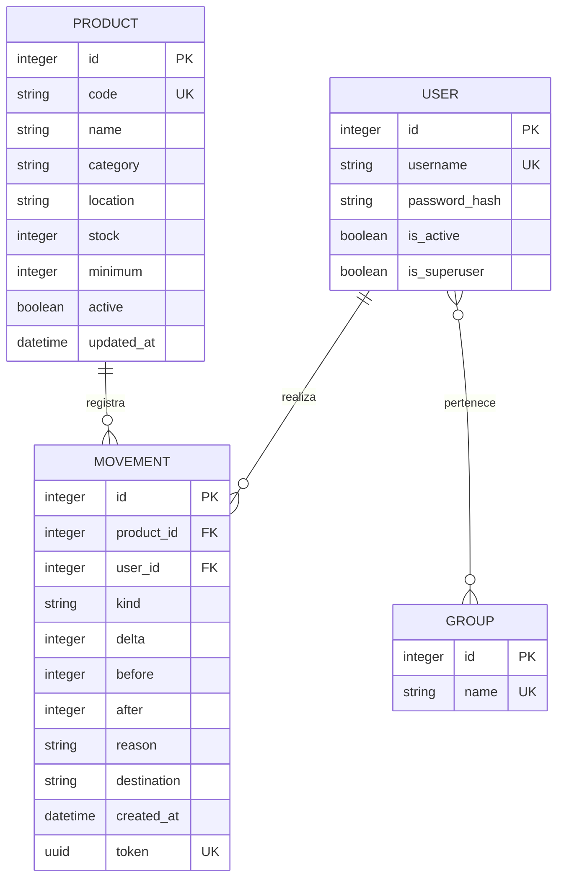

# Modelo de datos · SQLite

Todos los datos operativos y cuentas se guardan en `db.sqlite3`, en la raíz del proyecto. Las sesiones se almacenan en `django_session`. Refrescar, cerrar sesión y reiniciar no eliminan los registros.

## Product

| Atributo | Tipo Django / SQLite | Regla |
|---|---|---|
| id | BigAutoField / INTEGER | Clave primaria |
| code | CharField(30) / VARCHAR | Único, 3–30 caracteres A–Z, 0–9 y guion; normalizado en formulario |
| name | CharField(120) / VARCHAR | Obligatorio |
| category | CharField(30) / VARCHAR | Cuerdas, Percusión, Teclados, Audio, DJ o Accesorios |
| location | CharField(60) / VARCHAR | Obligatorio; ubicación física, p. ej. A-01-02 |
| stock | PositiveIntegerField / INTEGER | No editable en ProductForm; restricción SQL >= 0 |
| minimum | PositiveIntegerField / INTEGER | Umbral de alerta; 0–1.000.000 en formulario |
| active | BooleanField / BOOLEAN | Archivo lógico |
| updated_at | DateTimeField / DATETIME | Última modificación |

Stock máximo de 1.000.000 unidades aplicado por el servicio. Las ubicaciones son etiquetas libres; el sistema no calcula capacidad física ni cubicaje.

## Movement

| Atributo | Tipo | Regla |
|---|---|---|
| id | BigAutoField | Clave primaria; se muestra como MOV-00001 |
| product | ForeignKey(Product) | PROTECT: conserva la referencia histórica |
| kind | CharField(10) | entrada, salida, ajuste |
| delta | IntegerField | after - before; puede ser negativo |
| before | PositiveIntegerField | Saldo previo |
| after | PositiveIntegerField | Saldo final |
| reason | CharField(240) | Motivo obligatorio |
| destination | CharField(120) | Obligatorio en salida desde formulario/servicio |
| user | ForeignKey(User) | Responsable; PROTECT |
| created_at | DateTimeField | Fecha/hora asignada por servidor |
| token | UUIDField(unique=True) | Evita duplicar el mismo envío |

Los nombres/códigos se consultan desde el producto relacionado: editar metadatos del producto actualiza cómo se identifica en el historial. Los valores de stock, motivo, destino, responsable y fecha del movimiento no se editan.

## User y Group

Se usan los modelos estándar de Django: nombre de usuario único, contraseña con hash, nombres, correo, is_active, is_staff e is_superuser. Un superusuario tiene rol Administrador; el grupo Operador habilita escritura operativa; el resto usa Consulta. User y Group tienen relación muchos a muchos mediante auth_user_groups.

## Operaciones y validaciones

1. GET obtiene datos por ORM y construye un diccionario de contexto.
2. La plantilla muestra datos escapados con bucles, condiciones y filtros.
3. POST requiere sesión, permiso y token CSRF; los forms validan tipos, longitudes y reglas.
4. record_movement abre una transacción; comprueba si el token ya fue registrado.
5. Lee el producto activo y su saldo actual; calcula y valida el saldo nuevo.
6. Crea Movement y actualiza Product dentro de la misma transacción. Un error revierte ambos.
7. La vista añade un mensaje y redirige al historial: patrón POST/Redirect/GET.

Con SQLite, transaction_mode=IMMEDIATE protege frente a escritores simultáneos mediante reserva del bloqueo de escritura. El esquema ORM facilita migrar a PostgreSQL, donde select_for_update sí toma bloqueo de filas; esa migración no fue realizada ni probada.
