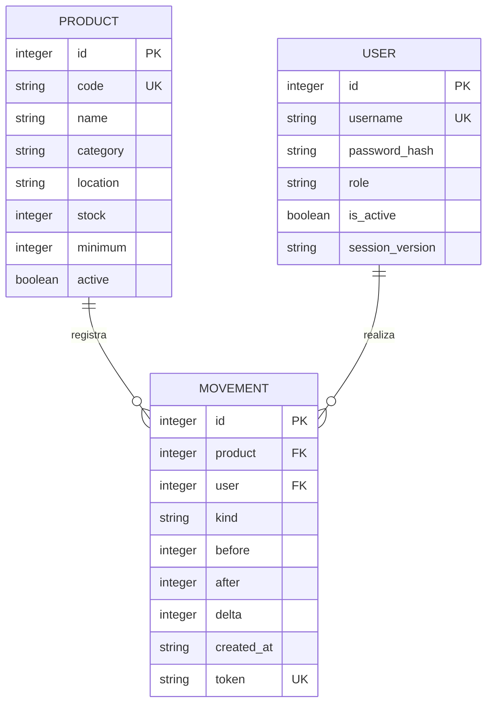

# Esquema de datos · JSON sin base de datos

`runtime/bodega.json` contiene tres listas: `products`, `movements` y `users`. `warehouse/store.py` convierte sus diccionarios en objetos de lectura para las plantillas. El archivo de catálogo demo sirve solo para la preparación inicial opcional.

## products

| Atributo | Tipo JSON | Regla |
|---|---|---|
| id | entero | Identificador único |
| code | texto | SKU único, normalizado, 3–30 caracteres A–Z, 0–9 y guion |
| name | texto | Obligatorio, máximo 120 caracteres |
| category | texto | Cuerdas, Percusión, Teclados, Audio, DJ o Accesorios |
| location | texto | Ubicación física obligatoria, máximo 60 caracteres |
| stock | entero | Entre 0 y 1.000.000; cambia mediante operaciones |
| minimum | entero | Entre 0 y 1.000.000; umbral de alerta |
| active | booleano | Archivo lógico sin perder historial |

## movements

| Atributo | Tipo JSON | Regla |
|---|---|---|
| id | entero | Identificador mostrado como MOV-00001 |
| product | entero | Identificador de producto existente |
| user | entero | Identificador del usuario responsable |
| kind | texto | entrada, salida o ajuste |
| before / after | enteros | Saldo previo y resultante, no negativos |
| delta | entero | after menos before |
| reason | texto | Motivo obligatorio, máximo 240 caracteres |
| destination | texto | Obligatorio para salida |
| created_at | texto ISO 8601 | Fecha con zona horaria |
| token | texto UUID | Identifica un envío y evita duplicarlo |

Los movimientos conservan valores, responsable y fecha. Los nombres del producto y usuario se consultan desde sus registros actuales. Los productos con historial se archivan; no se borran físicamente.

## users

| Atributo | Tipo JSON | Regla |
|---|---|---|
| id | entero | Identificador único |
| username | texto | Único, máximo 150 caracteres, admite espacios |
| first_name / last_name / email | texto | Datos de la cuenta |
| password | texto | Hash generado por Django; nunca contraseña en texto plano |
| is_active | booleano | Habilita o deshabilita ingreso |
| role | texto | Administrador, Operador o Consulta |
| session_version | texto UUID | Permite invalidar sesiones al salir o cambiar contraseña |

Este diagrama representa relaciones lógicas entre diccionarios, no tablas SQL. Las validaciones se ejecutan en Python. Se usan identificadores para enlazar los registros.

## Lectura y escritura

GET lee JSON y construye contextos; POST valida permiso, CSRF y formulario. Una modificación trabaja sobre una copia en memoria bajo un bloqueo de hilos y solo reemplaza el archivo después de completar la validación. El guardado sincroniza el archivo temporal antes del reemplazo. Historial y stock se guardan juntos.

El prototipo se ejecuta con un único proceso local. Los cambios confirmados permanecen al refrescar, salir, cerrar el navegador y reiniciar. Conserva runtime/bodega.json al actualizar el código.
